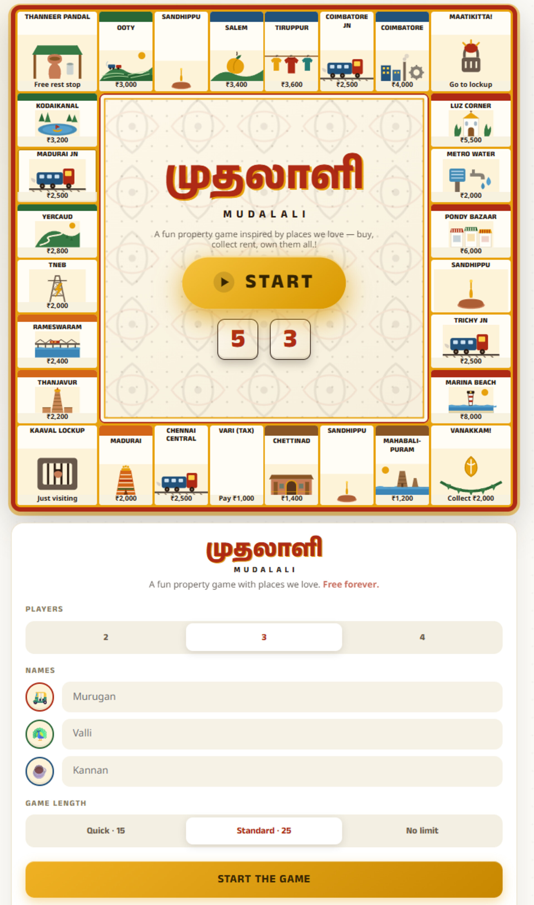

# Mudalali — முதலாளி

A free, single-page Monopoly-style board game themed around Tamil Nadu — roll the dice, buy Marina Beach and Madurai, collect rent, and become the Mudalali (முதலாளி, "boss/proprietor").

**Play now: [mudalali.mangoidiots.com](https://mudalali.mangoidiots.com)**

## About

- 2–4 players, pass-and-play on one device
- 28-tile board of Tamil Nadu landmarks with hand-drawn SVG illustrations
- Sound effects synthesized in-browser with the Web Audio API — no audio files to load
- Single self-contained HTML file: no build step, no external dependencies besides Google Fonts
- Mobile-first, works on any modern browser

## Tech

Everything — markup, CSS, and game logic — lives in [`index.html`](index.html). There's no framework, bundler, or server-side component; the whole game is one static file plus two images (favicon and social-preview card).

## Privacy & analytics

On the live site (mudalali.mangoidiots.com), the game quietly counts anonymous visits using Google Analytics (GA4) — just to get a sense of how many people are playing. It's kept out of your way on purpose:

- Loads only on the production site, never on localhost or test/preview builds
- Waits until the game has fully loaded, then loads during idle time so it never competes with gameplay
- Skips itself entirely if you're offline, or if your browser sends a Do Not Track or Global Privacy Control signal
- Never sees any game data — players, moves, purchases, progress all stay on your device
- Google sets its own first-party cookies to measure traffic; see [Google's privacy policy](https://policies.google.com/privacy) for details

The in-game "Privacy & analytics" section (next to "How to play") covers the same ground for players. See [`index.html`](index.html) for the implementation.

## Credits

Generated with Claude Fable 5 AI. See [`MUDALALI_PROMPTS.md`](MUDALALI_PROMPTS.md) for the full prompt history behind how the game was built.

This is a free, AI-generated game made for fun, intended to demonstrate what AI can create. The Tamil Nadu places, landmarks, and organisation names appearing in the game are included purely for entertainment and gameplay — no offence, endorsement, or representation is intended. All rights to names, logos, and trademarks belong to their respective owners.
